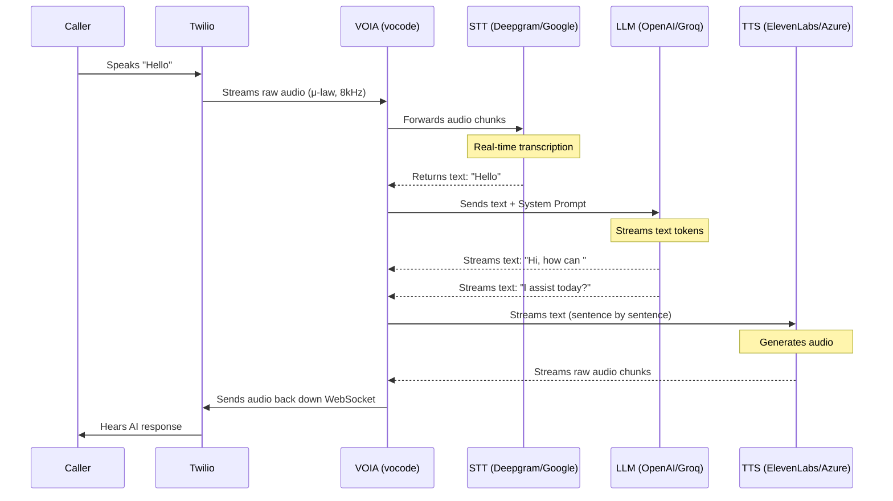
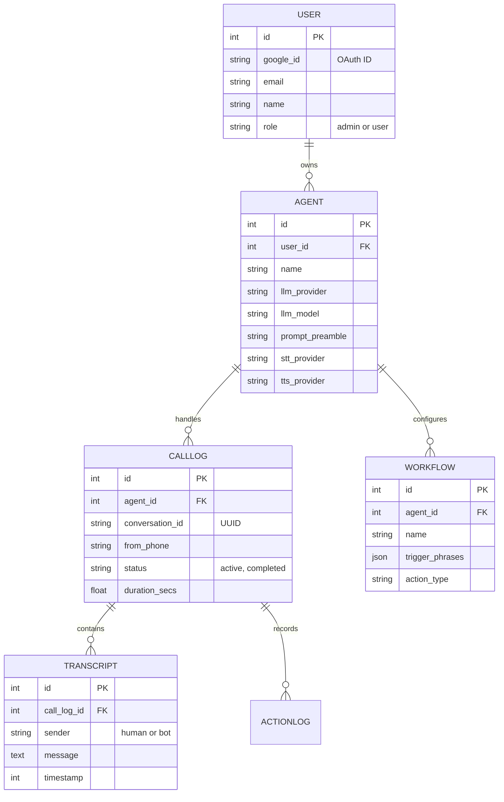

# 🚀 VOIA: The Absolute Beginner's Guide & Crash Course

Welcome to the VOIA backend! If you are a new developer joining the project, this document is written **specifically for you**. It will take you from zero to fully understanding how the code works, where things are, and how to build new features. 

We are building a **Retell AI competitor**: a plug-and-play voice agent platform. Users configure their agents on a frontend dashboard, and our backend handles the real-time phone calls.

---

## 🧠 1. The Core Concept (Deep Dive)

Retell AI disrupted the market by making voice AI easy: you pick an LLM (OpenAI/Anthropic), you pick a Voice (ElevenLabs/Azure), and they provide a phone number. 

**VOIA does exactly this, but open-source and modular.**

When someone calls a VOIA phone number, a continuous **WebSocket stream** is established. Unlike a standard REST API where you wait for a full sentence to finish, VOIA streams audio chunks in real-time to minimize latency (often sub-500ms).

Here is the exact real-time loop:



The magic of VOIA is the **Modular Provider System**. The user can mix and match any STT, LLM, and TTS provider they want via the database. Our `agent_factory.py` translates those database strings into the exact Pydantic configuration models that vocode expects.

---

## 🏗️ 2. Architecture & Tech Stack: The Big Picture

We use standard, modern Python tools.

*   **FastAPI**: The web framework serving our REST API (`main.py`).
*   **vocode-core**: The underlying voice engine that manages the real-time audio streams and WebSockets.
*   **SQLAlchemy (Async)**: How we talk to the SQLite database (`voia.db`).
*   **Redis**: In-memory storage to quickly pass call configurations between the REST API and the WebSocket server.
*   **Twilio**: The telecom provider that gives us phone numbers and routes calls to our server via webhooks.

### The Life of a Phone Call (Code Flow)

If you understand this, you understand 80% of the project. This is the exact sequence of events when someone dials your Twilio number:

1.  **Incoming Call**: The caller dials your Twilio number. Twilio sends an HTTP POST request to our webhook: `voice_platform/main.py -> @app.post("/inbound_call")`.
2.  **Config Loading**: Inside `/inbound_call`, we query the database to find the default `Agent` configuration and pre-create a `CallLog` entry to track the call from the very beginning.
3.  **Memory & Workflows**: We query the `CallLog` and `Transcript` tables (`memory.py`) to see if this caller has called before. If yes, we inject a summary of past calls into the AI's prompt. We also load relevant active workflow trigger phrases.
4.  **WebSocket Handoff**: We save all this configuration (Agent + STT + TTS + memory) into **Redis** and return an XML response (TwiML) to Twilio. This tells Twilio: *"Drop the HTTP connection and connect to our WebSocket server to stream audio."*
5.  **Agent Building**: As the WebSocket connection opens, `agents/agent_factory.py` leaps into action. It reads the agent settings from the database and instantiates the exact Python objects required for the chosen STT, LLM, and TTS providers.
6.  **Conversation**: The caller and AI begin talking. Meanwhile, `events/call_events.py` secretly listens in the background. Every time the human or the AI speaks, it saves the transcript to the database in real-time.

---

## 📂 3. Codebase Tour (Where do I write code?)

The project root contains `vocode/` (the open-source voice engine we built upon) and `voice_platform/` (our custom platform code). **You will spend 99% of your time in `voice_platform/`.**

Here is the exact map of `voice_platform/`:

```text
voice_platform/
├── main.py                 # 🟢 START HERE: The FastAPI app, webhook handlers, and server setup.
├── config.py               # Reads `.env` variables (API keys). If you add a new API key, add it here.
├── database.py             # Defines the SQLite tables (Users, Agents, CallLogs, Transcripts).
├── auth.py                 # Handles Google Login and JWT token creation.
│
├── api/                    # 🌐 The REST API endpoints (Frontend talks to these)
│   ├── agent_routes.py     # Create/Edit/Delete Agents
│   ├── call_routes.py      # View call history and transcripts
│   ├── review_routes.py    # Human-in-the-loop dashboard logic
│   ├── settings_routes.py  # Admin settings configuration
│   └── workflow_routes.py  # Automation and trigger phrase management
│
├── agents/                 
│   └── agent_factory.py    # 🏭 The Factory. Translates DB settings -> vocode Python objects.
│
├── actions/
│   └── action_executor.py  # ⚡ Webhook executor for when the AI needs to trigger external tools.
│
├── events/                 
│   └── call_events.py      # 💾 Persists call transcripts and events to the database in real-time.
│
└── memory.py               # Fetches past call transcripts to inject into the active call prompt.
```

---

## 🛠️ 4. Crash Course: Setting Up the Local Dev Environment

Let's get the code running on your machine. You need macOS/Linux and Python 3.10+.

**Step 1: Start Redis**
We need Redis running in the background for vocode to store active call configurations between API requests and WebSocket connections.
```bash
redis-server
```

**Step 2: Set up the Python Environment**
We use a standard virtual environment.
```bash
python -m venv .venv
source .venv/bin/activate
# Install all required dependencies
pip install -e ".[twilio]" aiosqlite "python-jose[cryptography]" google-auth google-auth-oauthlib pyngrok audioop-lts "sqlalchemy[asyncio]"
```

**Step 3: Provide API Keys (.env)**
Create a file named `.env` inside the `voice_platform/` directory. **Do NOT commit this to git.** You need at least the following keys to get basic calling working:
```env
TWILIO_ACCOUNT_SID=...
TWILIO_AUTH_TOKEN=...
DEEPGRAM_API_KEY=...
OPENAI_API_KEY=...
JWT_SECRET=super_secret_string_for_local_dev
```

**Step 4: Start the FastAPI Server**
```bash
# Make sure you are in the root vocode-core directory
.venv/bin/python -m uvicorn voice_platform.main:app --host 0.0.0.0 --port 3000 --reload
```
*Magic: The server uses `ngrok` automatically on startup to expose your local port 3000 to the internet. Twilio needs a public internet URL to send webhooks to, and this handles it for you.*

---

## 🏭 5. Crash Course: The Agent Factory (`agent_factory.py`)

This file is the beating heart of the modular system. When a call connects, we need to know what AI model to use.

Let's look at how we build the LLM config:

```python
def build_agent_config(db_agent) -> AgentConfig:
    provider = db_agent.llm_provider.lower()
    
    # We figure out which API key to use. Did the user provide their own via the dashboard?
    # If not, fall back to the main platform key defined in .env.
    api_key = _resolve_llm_api_key(provider, db_agent)
    
    # The secret sauce: Google Gemini, Groq, and Anthropic all offer OpenAI-compatible API endpoints!
    # Instead of writing custom logic for each, we just change the "base URL".
    base_url = _resolve_base_url(provider) 
    
    config = ChatGPTAgentConfig(
        openai_api_key=api_key,
        base_url_override=base_url, # e.g. "https://api.groq.com/openai/v1"
        model_name=db_agent.llm_model,
        prompt_preamble=db_agent.prompt_preamble, # The system prompt
        end_conversation_on_goodbye=db_agent.end_on_goodbye,
        ...
    )
    return config
```

### 🚀 Your First Task: Adding a New TTS Provider

To prove how modular this is, let's say your task is to **"Add support for a new TTS provider called 'SuperVoice'."**

Here is exactly how you would do it:

1.  **Database (`database.py`)**: Nothing to do! The `tts_provider` column is just a String, it comfortably holds "supervoice".
2.  **Config File (`config.py`)**: Add `supervoice_api_key: Optional[str] = None` so FastAPI knows to look for `SUPERVOICE_API_KEY` in the `.env` file.
3.  **Agent Factory (`agents/agent_factory.py`)**: 
    Go to `build_synthesizer_config()` and add exactly three lines of code:
    ```python
    elif provider == "supervoice":
        api_key = db_agent.tts_api_key or settings.supervoice_api_key
        return SuperVoiceSynthesizerConfig(api_key=api_key)
    ```
4.  **Frontend Dashboard**: Tell the frontend developers to add "SuperVoice" to their dropdown menu.

That's it! You didn't touch the complex audio streaming or WebSocket logic once.

---

## 💾 6. Crash Course: The Database (`database.py`)

We use SQLite via SQLAlchemy `async_session()`. It's local and self-contained in `voia.db`.

**The Database Architecture:**



**(Gotcha!): Database Migrations**
If you add a new column to a table entirely, `SQLAlchemy.create_all()` won't automatically update existing tables. During local dev, the quickest fix is simply `rm voice_platform/voia.db` to delete the DB and let the system recreate a fresh one on startup.

---

## 📞 7. Crash Course: Webhooks and Call Routing (`main.py`)

Let's look at the actual entry point for all phone calls. Open `main.py` and find `@app.post("/inbound_call")`.

When someone dials the Twilio number, Twilio POSTs data to this endpoint.

```python
@app.post("/inbound_call")
async def inbound_call(From: str = Form(...), To: str = Form(...)):
    
    # 1. Grab the Default Agent Config
    # If a user changes their prompt in the dashboard, we load the fresh config here.
    agent_config, transcriber, synthesizer = await _get_default_configs()
    
    # 2. Add Cross-Call Memory
    # Has this person called before? We ask our memory module.
    memory_summary = await get_caller_history_summary(From)
    if memory_summary:
        # We append past conversations to the system prompt!
        agent_config.prompt_preamble += memory_summary
        
    ...
```

Instead of using vocode's default routing, we hijacked the `/inbound_call` route. Why? Because we need to uniquely customize the agent *per caller* (injecting memory) and *per user* (querying the database) before handing the call over to the WebSocket server.

## 🕵️ 8. How to Understand the Codebase (Where to Look)

When you are asked to fix a bug or add a feature, it can be overwhelming to know where to start. Use this mental map:

### 1. "I need to fix an API or add a Dashboard feature"
**Where to look:** `voice_platform/api/`
This is standard FastAPI REST development. Look at `agent_routes.py` for agent settings, `call_routes.py` for history, or `dashboard_routes.py` for analytics.

### 2. "I need to add a new AI Provider (OpenAI alternative, new TTS, etc.)"
**Where to look:** `voice_platform/agents/agent_factory.py`
This is the ONLY file that cares about providers. You don't need to touch the WebSocket or audio streaming code. Just tell `agent_factory.py` how to translate the new provider's API key into a `vocode` config object.

### 3. "I need to change how the AI actually behaves during a call"
**Where to look:** `voice_platform/main.py` -> `@app.post("/inbound_call")`
This is where the system prompt is initially assembled. If you want the AI to introduce itself differently, or want to inject real-time data (like checking a database for inventory before the call connects), you inject it into `agent_config.prompt_preamble` right here.

### 4. "I need to save new data during a call"
**Where to look:** `voice_platform/events/call_events.py`
This is the hidden listener. `PersistentEventsManager` catches every word spoken and every action taken. If you want to track "Did the caller sound angry?", you would add sentiment analysis code here to analyze the transcript and save it to the DB.

---

## 🤝 9. How to Contribute

We follow a strict, modular development philosophy. To keep the project stable, adhere to these rules:

1.  **Do Not Touch `vocode-core`**: The `vocode/` directory is an open-source library. If you edit code inside `vocode/`, it will break when we upgrade. **All custom logic must live in `voice_platform/`.**
2.  **Database Changes Need Restarts**: We are using SQLite for simplicity during development. If you touch `database.py` to add a column, you must delete your local `voia.db` file and restart the server to apply the schema change.
3.  **Environment Variables First**: Never hardcode API keys. Always add them to `config.py` and your local `.env` file.
4.  **Fallback Chains**: Look at `agent_factory.py`. Notice how we try `db_agent.tts_api_key` *before* `settings.elevenlabs_api_key`. The user's specific database settings ALWAYS override the platform's `.env` defaults.

Good luck, and welcome to the team! If you understand the flow from Twilio Webhook -> Database Config Loading -> Agent Factory -> WebSocket Streaming, you are ready to build anything on VOIA.
